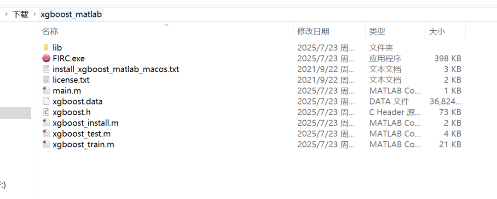
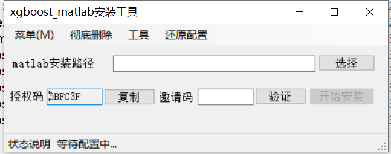
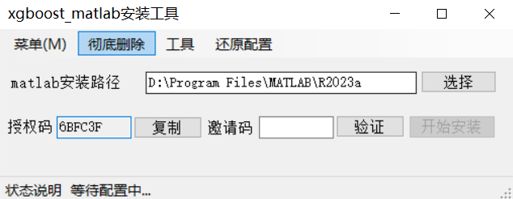
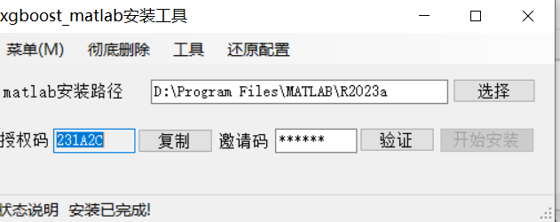
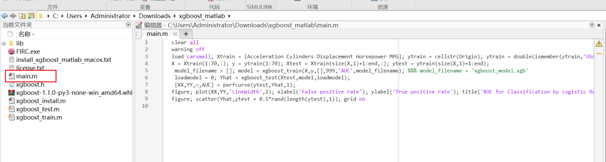
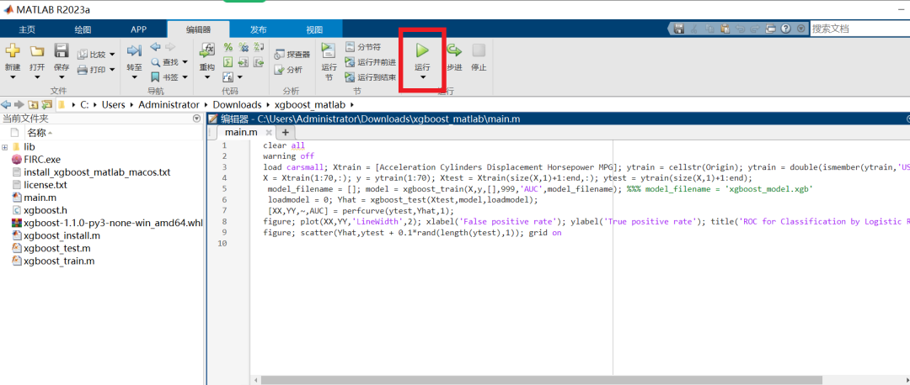
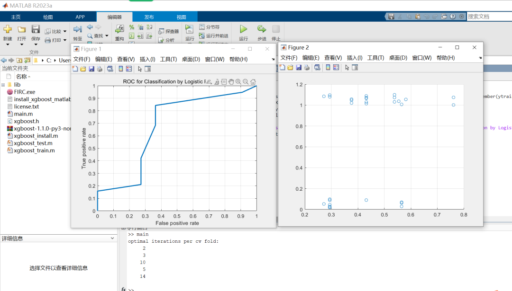

# [matlab] Simple Installation Guide for xgboost Algorithm Based on MATLAB

[Preface]There are too few online tutorials on installing xgboost based on MATLAB, making it nearly impossible to find. Therefore, I have created a simple installation guide.

[Preface]
There are too few installation tutorials for MATLAB-based xgboost online, making it nearly impossible to find. Therefore, I have created a simple installation guide.

[Installation Prerequisites]
MATLAB software is required, with the higher version being better. I am using MATLAB 2023a. Theoretically, it supports MATLAB 2018a and above, so you need to install MATLAB yourself in advance.

[Installation Steps]

Firstly, download the compressed package xgboost_matlab_installer.7z.

 Edit

Unzip this installer package into a non-Chinese directory without spaces. For example, I unzipped it to...

C:\Users\Administrator\Downloads\xgboost_matlab

 Edit

Open the FIRC.exe software, and the interface is as follows.

 Edit

Clicking on the text of the MATLAB installation path can automatically obtain the MATLAB installation path.

 Edit

After pasting the invite code, click "Start Installation". The status indicates that the installation is complete, and it should take about 3 seconds to complete. The software will automatically configure MATLAB and complete all XGBoost configurations.

 Edit

[Verification Installation]

We open MATLAB 2023a and switch to the XGBoost installation directory.

 Edit

You can see that there is a main.m file, which is the test example. We click to run it.

 Edit

The results are as follows:

 Edit

Installation completed! Summary as follows:

Step 1: Download and extract the software installation package.

Step 2: Import the MATLAB installation directory on the software and click "Start Installation" to wait for the installation to complete.

Step 3: Verification, the code is actually copied from xgboost_train:

```
clear all
warning off
load carsmall; Xtrain = [Acceleration Cylinders Displacement Horsepower MPG]; ytrain = cellstr(Origin); ytrain = double(ismember(ytrain,'USA'));
X = Xtrain(1:70,:); y = ytrain(1:70); Xtest = Xtrain(size(X,1)+1:end,:); ytest = ytrain(size(X,1)+1:end);
 model_filename = []; model = xgboost_train(X,y,[],999,'AUC',model_filename); %%% model_filename = 'xgboost_model.xgb'
 loadmodel = 0; Yhat = xgboost_test(Xtest,model,loadmodel);
 [XX,YY,~,AUC] = perfcurve(ytest,Yhat,1);
figure; plot(XX,YY,'LineWidth',2); xlabel('False positive rate'); ylabel('True positive rate'); title('ROC for Classification by Logistic Regression'); grid on
figure; scatter(Yhat,ytest + 0.1*rand(length(ytest),1)); grid on

```


## Payment

Here is a pay link on Stripe ( https://buy.stripe.com/3cs8yP7sY87d0vu9AB ). Please contact me lonlonago@foxmail.com after funding $89, and I will send you a complete data files , thank you!


